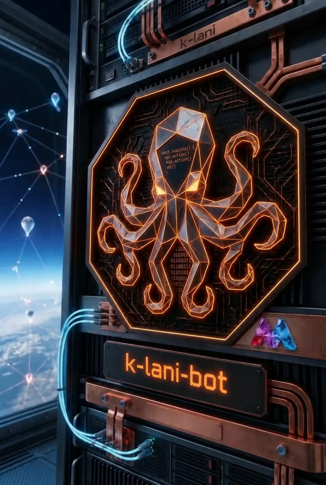
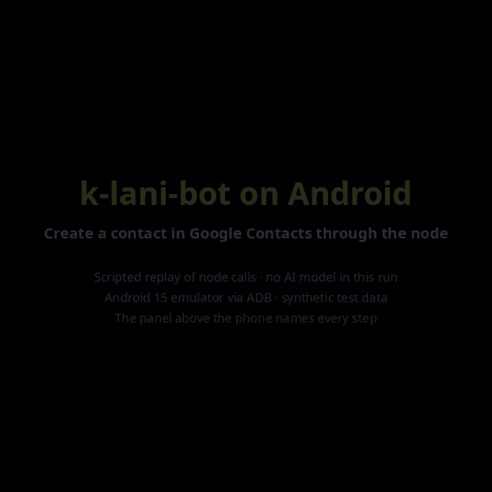
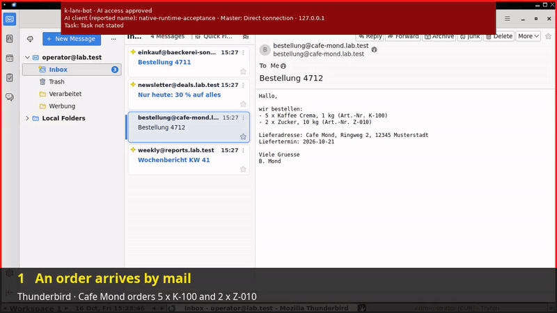
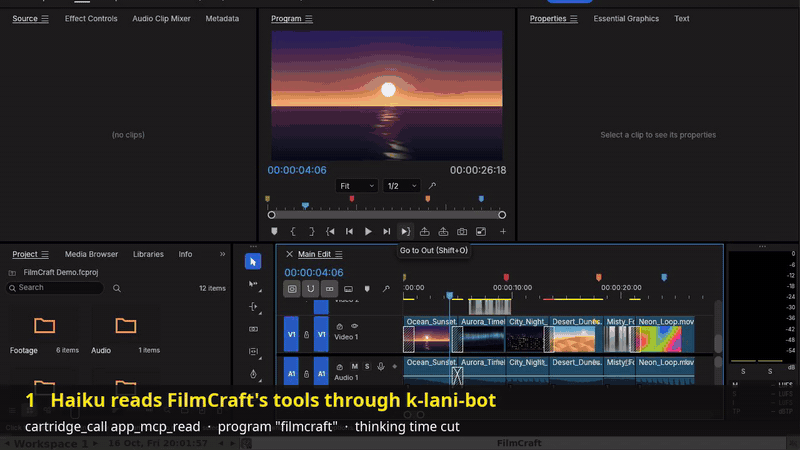
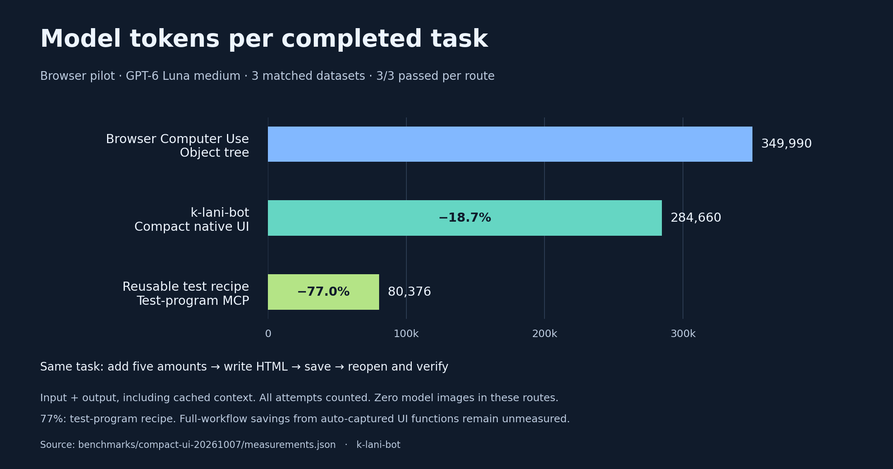

<div align="center">

<h1>k-lani-bot</h1>
<h3>Your AI learns a desktop program once. After that, the whole task is a single call.</h3>
<p><strong>MCP for everything.</strong><br>Give AI programmable hands.</p>



<p><code>DEVELOPER ALPHA</code> &nbsp; <code>WINDOWS / macOS / LINUX</code> &nbsp; <code>BSL 1.1</code></p>

<p>
<a href="docs/GETTING-STARTED.md"><strong>Get started</strong></a> &middot;
<a href="docs/AGENT-AUTHORING.md">Build your first action</a> &middot;
<a href="docs/BENCHMARKS.md">Token savings</a> &middot;
<a href="https://ko-fi.com/mkalani">Support on Ko-fi</a>
</p>

</div>

```text
+----------------------------------------------------------------+
|                                                                |
|   _          _                   _           _                 |
|  | | __     | | __ _ _ __ (_)    | |__   ___ | |_              |
|  | |/ /_____| |/ _` | '_ \| |____| '_ \ / _ \| __|             |
|  |   <______| | (_| | | | | |____| |_) | (_) | |_              |
|  |_|\_\     |_|\__,_|_| |_|_|    |_.__/ \___/ \__|             |
|                                                                |
|         ONE MCP. MANY MACHINES. PROGRAMMABLE HANDS.            |
|                                                                |
|    [01] CONNECT    [02] EXPLORE    [03] BUILD    [04] REUSE    |
|                                                                |
+------------------[ WELCOME TO THE BOT BOARD ]------------------+
```

**Turn a task you can demonstrate into an action your AI can call again.**

k-lani-bot connects AI assistants to real applications through the **Model Context Protocol (MCP)**.
The agent explores an unfamiliar operation, writes and verifies a reusable procedure, and saves it as a callable action.
Next time, it supplies fresh inputs. The procedure performs its steps and checks locally, returning a compact result.

**The agent builds the tools it will use.** That is how repeated work can consume less model context.
The aim is one call per business operation, with authoring costs kept separate from reuse.

**Computer Use, with fewer screenshots.** Our **Compact UI** mode navigates real applications using relevant controls,
text and changes, with screenshots available when a visual check is needed. The agent can operate before a reusable
action exists, without requesting a new full-screen image after every step. Saved actions then keep known steps and
checks outside the model's context. The browser pilot below measured **18.7% fewer tokens for Compact UI** than its
Computer Use baseline; the benefit is not limited to already-written cartridges.

## 01 / Teach once. Call again.

```text
  IDENTIFY --> EXPLORE --> PROGRAM --> VERIFY --> SAVE
                                                   |
                     IMPROVE <--- CHECK <--- REUSE <-+
```

1. **Identify the application.** Establish its actual version, available access and the permitted task.
2. **Build the missing action.** Use native APIs, accessibility or screenshot-assisted discovery to understand the operation.
3. **Verify and save it.** Put the complete parameterized procedure and result checks in the application's cartridge.
4. **Use your new hands.** Call the saved function with fresh inputs; investigate the UI again when a result or version changes.

A **cartridge** describes one application variant and version. A saved action can combine application capabilities through
stable input/result contracts. The design lets a different mail application supply the same capability after qualification.
The caller should need the task's inputs and outcome, rather than every click along the way.

> **For agents:** Your job is to build the missing tools and then use them yourself.
> A repeated screenshot-and-click loop is discovery. A verified, reusable MCP action is the intended result.

[Read the worked authoring example](docs/AGENT-AUTHORING.md) · [Agent operating instructions](docs/AGENT-OPERATIONS.md)

## 02 / One MCP. Your whole fleet.

**Run k-lani-bot on Windows, macOS or Linux. Reach registered nodes on other computers through that one MCP.**
The controller and target operating systems can differ.

```text
  YOUR AI CLIENT
       |
       v
  k-lani-bot                         k-lani-node
  Windows / macOS / Linux     +----> Windows applications
       |                     +----> macOS applications
       +--- registered ------+----> Linux applications
            node access      +----> Android via host ADB (*)
                             +----> iOS Simulator bridge (*)

  (*) Current mobile routes; full mobile-node coverage is a goal.
```

**Both the MCP/controller and the node are implemented and built for Windows, macOS and Linux.**
Approved nodes can connect back to the controller. Each node applies its own permissions and operates the target applications.
The target architecture extends this to a mixed fleet of Linux, macOS, Windows, Android and iOS nodes.

| Platform | MCP/controller | Current application access |
| --- | --- | --- |
| Windows | Implemented and built | Native UI Automation |
| macOS | Implemented and built | Native Accessibility, with OS permissions |
| Linux | Implemented and built | AT-SPI and X11; limited Wayland access |
| Android | Via a desktop host | ADB device/emulator bridge; foreground input |
| iOS | Via a macOS host | Experimental XCTest simulator bridge for one configured app |

Desktop builds do not establish every native workflow. Android currently uses a host bridge; general physical iPhone/iPad
nodes are not implemented. Browsers are operated through the host's application-access backend.



[Download the full-quality MP4](docs/media/android-contact-demo.mp4)

**Android through the node:** the node reads the phone's accessibility tree over ADB, finds each field by name, types,
saves and then verifies that "Ada Lovelace" is shown. The panel above the phone names every step as it runs. This is a
scripted replay of node calls without an AI model (17 October 2026, Android 15 emulator, synthetic data; the administrator
switched the backup requirement off for this disposable emulator copy). Nothing here mirrors a physical iPhone.

<details>
<summary><strong>Current connection details</strong></summary>

Core MCP and native program cartridges can select multiple registered nodes. The compact UI profile currently uses one
default node. Newly registered nodes require an MCP process restart; automatic registry refresh is not implemented.

Both roles currently share the executable `k-lani-bot-node` (`.exe` on Windows), selected by startup options.
The code calls the MCP routing part a *gateway*. It belongs to k-lani-bot and does not require an extra Linux server.

[Connection routes and commands](docs/AGENT-OPERATIONS.md#2-connect-to-the-correct-node)

</details>

## 03 / A real action: mail to Tryton

> **What is Tryton?** [Tryton](https://www.tryton.org) is a free, open-source business application (ERP) for customers,
> sales orders, purchasing, invoices and stock: the kind of desktop program in which office staff type orders all day.
> It stands in here for any business software you use. The action operates Tryton's normal desktop window, just as a
> person would, rather than calling a database or a special interface.

The [worked example](docs/AGENT-AUTHORING.md) takes order data from a Thunderbird mail and creates a Tryton sales draft.
Its authored `tryton_create_draft_sale` function adds two positions, saves the draft and verifies the result.



[Download the full-quality MP4](docs/media/mail-to-tryton-demo.mp4)

**See it before you install anything:** the 34-second animation above is a real, uncut run
in the isolated lab (16 October 2026, current node, Tryton 6.0.34-1, synthetic test data; the administrator switched the
backup requirement off for this disposable database). The order mail was opened by hand for the camera; everything in
Tryton then happened through one `cartridge_call`: 79 steps, verified, 15.8 s.

```text
  Order data from mail
           |
           v
  ONE MCP CALL: tryton_create_draft_sale
           |
           +-- find customer -- add lines -- save -- verify
           |
           v
  Checked sales draft
```

The recorded native acceptance reused the same two-position procedure after a restart, with fresh inputs:
**one outer MCP call per order, 79 internal steps, independently checked drafts.**
Mail reading and interpretation remain separate. This example uses existing customers/products and creates drafts only.
Its qualification covers the recorded Tryton build; full-workflow token savings have not been measured.

<details>
<summary><strong>Build and test the example without running Thunderbird or Tryton</strong></summary>

From the repository root, with Python 3 and a new output directory:

```bash
python3 examples/agent-authoring/mail-to-tryton/build.py \
  .artifacts/agent-example/programs/tryton/6.0.34-1 --lines 2
python3 -m unittest discover -s examples/agent-authoring/mail-to-tryton -p 'test_*.py'
```

These commands compile and test the procedure. Executing it needs the qualified application environment, authorized test
data and verified backups. The [walkthrough](docs/AGENT-AUTHORING.md#an-executable-example-make-a-whole-tryton-order-one-call)
provides the actual MCP request, version requirements and partial-failure limits.

</details>

## 04 / Less context. Measured.

### FilmCraft: one video task, measured with Claude



[Download the full-quality MP4](docs/media/programmable-app-mcps-filmcraft-demo.mp4)

Some programs ship their own MCP server, such as the [FilmCraft](https://github.com/storytold/filmcraft) video editor.
With **Programmable App MCPs** the node forwards to it under the administrator's policy, and a sequence that worked can be
stored as one function. The task: import a 34-second video into FilmCraft 0.8.0, make a new sequence from it and export an
800×450 GIF at 10 fps without sound. Every run started in a fresh lab and finished the task;
the 47-second animation above shows a real, recorded Haiku 5.5 run.

| Route | Model | Model tokens | Calls | Time |
| --- | --- | ---: | ---: | ---: |
| Screenshots, clicks and keys | Sonnet 5.5 | 1,246,818 | 78 | 236 s |
| FilmCraft's own MCP, without k-lani-bot | Haiku 5.5 | 347,815 | 13 | 67 s |
| FilmCraft's MCP through k-lani-bot | Haiku 5.5 | 304,472 | 16 | 95 s |
| FilmCraft's MCP through k-lani-bot | Sonnet 5.5 | 244,811 | 15 | 84 s |
| Stored function in k-lani-bot, reused | Sonnet 5.5 | 149,070 | 7 | – |
| Stored function in k-lani-bot, reused | Haiku 5.5 | **61,094** | 3 | – |

Tokens include cached input and output. These are single runs, so expect variance. The stored-function rows count reuse
only; storing the function once is a separate, uncounted authoring cost. FilmCraft publishes no accessibility tree on Linux,
so the compact UI route alone could not finish this task; that gap led to the `ui_input` last resort.
[How Programmable App MCPs work](docs/AGENT-OPERATIONS.md#programmable-app-mcps)

### Browser pilot

Our browser pilot compared the same completed report-writing task across three routes.

| Route | Model tokens per completed task | Reduction |
| --- | ---: | ---: |
| Browser Computer Use (object-tree route) | 349,990 | Baseline |
| k-lani-bot compact UI | 284,660 | **18.7%** |
| Reusable test-program MCP recipe | 80,376 | **77.0%** |

**GPT-6 Luna · medium effort · three datasets · 3/3 successes per route.** Tokens include cached input and output.
The 77% result belongs to the controlled test-program recipe. It is not a universal saving or a measurement of the
complete mail-to-Tryton workflow. Automatically captured functions have separate restart/reuse evidence.
All three compared routes sent zero images in this pilot: these figures measure interaction/context savings, not an
isolated reduction in image tokens. Screenshot frequency and total savings depend on the task and selected route.

**Also tested with Claude.** In a smaller Claude Code lab pilot on a desktop text editor, every run with a prepared
cartridge was correct: Haiku 5.5 12/12, Sonnet 5.5 6/6 and Opus 5.5 at medium effort 1/1. On the longer task Sonnet
read **32% less context** with the cartridge than with screenshots. Haiku was correct but still read more context than
screenshots, because it re-checked results; the result reports were improved afterwards and Haiku has not been re-measured.
Our recommendation: use a strong model, for example Opus 5.5 at medium effort or higher, once to analyse the screens,
author and verify the cartridges and compose them into actions that span several programs, such as mail to ERP.
Routine calls then use these saved actions with fresh inputs; smaller models completed saved actions correctly.
This is a recommendation from a small single-application pilot, not a measured model ranking. [Details](docs/BENCHMARKS.md#claude-pilot)

<details>
<summary><strong>View the comparison chart</strong></summary>



</details>

[Measurements, limitations and reproduction](docs/BENCHMARKS.md)

## 05 / Get connected

1. **Build for the host.** Follow the [Windows/Linux quickstart](docs/GETTING-STARTED.md#build) or the
   [macOS setup](cartridges/apple/macos-27-de/README.md). Both MCP and node roles use the platform build.
2. **Start or reuse your nodes.** Preserve existing registrations. For a new local test node, follow
   [initialization and startup](docs/GETTING-STARTED.md#start-the-node).
3. **Connect your AI client to k-lani-bot.** Use the [native MCP configuration](docs/GETTING-STARTED.md#connect-your-mcp-client).
   Give the agent the [authoring instructions](docs/AGENT-AUTHORING.md#short-instruction-to-give-a-smaller-agent).

In the compact profile, start with `ui_info`. Reuse a listed action through `cartridge_call`, or explore and author a missing
one. Use the [multi-node routes](docs/AGENT-OPERATIONS.md#2-connect-to-the-correct-node) for registered-node selection.

Self-contained builds include .NET. Building needs the SDK in [global.json](global.json); the native MCP needs no Node.js
runtime. Node.js is used by optional development tooling. Your existing MCP client supplies the AI connection; k-lani-bot
does not require a separate model API subscription. Docker is used for isolated tests and optional worker environments.

**Source stays portable; test packages stay local.** The planned Git publication includes source and build instructions for
all three desktop platforms. Local packages, test images, credentials and raw traces remain outside Git.
[Build requirements](docs/GETTING-STARTED.md#runtime-and-build-requirements) · [Release process](docs/RELEASING.md)

## 06 / What the alpha can do

| State | Scope |
| --- | --- |
| Implemented and tested | Native MCP, compact UI discovery, verified capture/reuse and an authored Tryton draft action reused after restart |
| Implemented and lab-tested | Programmable App MCPs with stored functions (FilmCraft) and the `ui_input` last resort for windows without a tree (Linux/X11) |
| Internal components | Efficiency summary, encrypted closed-file backup and credential broker; administration through MCP remains incomplete |
| Requires more implementation or qualification | General installation/removal, whole-machine recovery, automatic community-cartridge activation and full mobile nodes |

Existing exact-binary acceptance covers a Linux/X11 candidate. Other native platform workflows require their own acceptance;
building them successfully is not the same check. Broader Outlook/PDF/Excel workflows remain planned.

[Administration boundaries](docs/ADMINISTRATION-FOUNDATION.md) · [Architecture](docs/DESKTOP-AUTOMATION.md) ·
[Platform details](docs/GETTING-STARTED.md#platform-backends)

## 07 / License & responsible use

**Private, non-commercial use is free. Business production requires an acquired commercial license.**

| Your use | Terms |
| --- | --- |
| Your own private, non-commercial use | Free under the BSL Additional Use Grant |
| Non-production development, testing and evaluation, including businesses | Free under BSL 1.1 |
| Production for a business, employer, profession or organization | Separate commercial license required |

Read [LICENSE.md](LICENSE.md) and the [license explanation](docs/legal/LICENSING.md).
For business licensing, contact **support@kalanis.de**. This version's Change Date is **2030-10-01**, with **MIT** as Change
License, subject to the license's earlier-date rule. Each version states its own Change Date in its LICENSE.md.

k-lani-bot is **AI-assisted robotic process automation (RPA)** for authorized application use and computer administration.
The purpose includes handling mail, entering ERP data, converting files and qualified maintenance; the alpha's actual scope
is listed above. It shares the established automation purpose of [AutoIt](https://www.autoitscript.com/site/autoit/),
[Power Automate desktop flows](https://learn.microsoft.com/en-us/power-automate/desktop-flows/introduction) and
[UiPath RPA](https://www.uipath.com/rpa/robotic-process-automation). This is a purpose comparison, not vendor endorsement or
an assertion of equivalent features.

Start in a disposable application environment. Before changing real data, verify authority, the target and task, permissions,
consistent backups and a working recovery path. This developer alpha is supplied in its current state, with known limits
and no promise of error-free or damage-free operation. Source and AI-assisted reviews help assess a deployment; they do not
establish blanket safety or CRA conformity.

[Operator responsibilities](docs/legal/OPERATOR-SAFETY.md) · [Deployment review record](docs/legal/OPERATOR-REVIEW.md)

## 08 / Keep the tentacles moving

If k-lani-bot saves you time, you can [support its development on Ko-fi](https://ko-fi.com/mkalani).
Contributions help fund continued work. They are voluntary and do not purchase or replace a business production license.

Found something while reviewing the code or a cartridge? Report actionable findings with the version, expected result and
a small sanitized reproduction. Mark unconfirmed AI suggestions as such. Share security findings **privately** through
[SECURITY.md](SECURITY.md); use [CONTRIBUTING.md](CONTRIBUTING.md) for ordinary bugs and improvements.

```text
  +-----------------------------------------------------------+
  |  END OF TRANSMISSION                                      |
  |  Build useful hands. Share what you learn. Come back soon.|
  +-----------------------------------------------------------+
```
