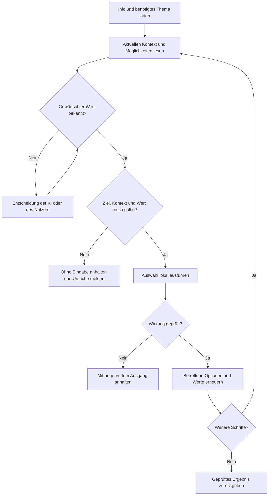
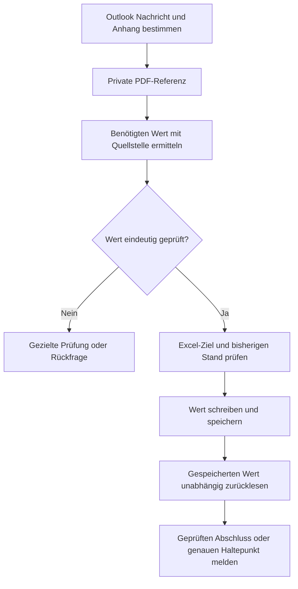

# Desktopprogramme mit sparsamen MCP Cartridges verbinden und bedienen

k-lani-bot soll Browseranwendungen und native Desktopprogramme bedienen, ihre aktuell möglichen Aktionen anbieten und bekannte Schritte lokal ausführen.
Die KI erhält nur die Informationen, die sie für die nächste Entscheidung und die Ergebnisprüfung braucht.
Ein Produktkonfigurator kann sich dabei nach jeder Auswahl verändern: Felder erscheinen, Optionen entfallen und bereits
gesetzte Werte werden ungültig. Ein Ablauf kann außerdem einen Wert aus einem Outlook-PDF-Anhang ermitteln und in einer lokalen
Excel-Datei speichern. Cartridges und verbindende Rezepte müssen ihre Quellen, Ziele und Ergebnisse eindeutig prüfen.

Dieses Konzept beschreibt den Zielvertrag und die Anleitung für seine Umsetzung. Die vorgeschlagenen Funktionen und
Abhängigkeitsprüfungen sind noch keine implementierte Konfigurator- oder Outlook-PDF-Excel-Anbindung. Ein Programm je Variante und Anwendungsversion bleibt
eine Cartridge; Formulare, Zustände und Themen gehören innerhalb dieser Cartridge zusammen.

## Desktopprogramme und Dokumente

Der Zugriff richtet sich nach den Fähigkeiten des Programms auf dem betriebenen Node. Browserinhalte können über ihre
zugängliche Oberfläche bedient werden; ein vorhandenes Programm-MCP oder eine geeignete API kann denselben Auftrag direkter
ausführen. Native Desktopprogramme können Objektmodelle, APIs, Accessibility-Elemente oder dokumentierte Tastaturwege anbieten.
Die gewählte Route und ihre Kompatibilität werden pro Anwendung und Funktion geprüft.

Eine UI-Funktion braucht frische Ziele im richtigen Fenster beziehungsweise Dokument. Eine native API-Funktion prüft dagegen
ihre Anwendungsinstanz, Objektidentitäten, Werte und Vorbedingungen. Sie braucht keinen zusätzlichen Bildschirm- oder
Baumabruf, wenn der Objektzugriff den Auftrag samt Prüfung vollständig abdeckt.

E-Mails, PDF-Anhänge und Arbeitsmappen sind zugleich Datenobjekte. Für die lokale Textauswertung eines PDF genügt ein
geeigneter Dokumentzugriff; ein PDF-Viewer muss dafür nicht geöffnet werden. Wird die Viewer-Oberfläche benötigt, wird dessen
Programm-Cartridge geladen. Bei Excel werden die Bedienung einer laufenden Sitzung und die Bearbeitung einer geschlossenen
Datei als unterschiedliche Zugriffswege mit jeweils geprüften Formaten und Fähigkeiten behandelt.

Der Formularscanner unterstützt die UI-Routen. Die bisherige Scanner-Abnahme verwendet den echten nativen Node-Zugang zu
einer privaten Browser-Testanwendung unter Linux. Sie belegt weder die allgemeine Bedienbarkeit beliebiger Desktopprogramme
noch eine durchgängige Outlook-PDF-Excel-Verarbeitung. Dafür sind eigene Desktop-Abnahmen erforderlich.

## Scanner und Bedienung

Der Scanner liest die erreichbare Oberfläche beziehungsweise eine native Programmschnittstelle. Er erfasst Feldidentitäten,
Typen, aktuelle Inhalte auf Anforderung, verfügbare Optionen und belegbare Eigenschaften. Er löst keine fachlichen Aktionen aus.
Eine aus einer Rolle abgeleitete Möglichkeit wie „Text setzen“ ist zunächst ein Kandidat. Erst eine erfolgreich beobachtete
Bedienung mit passender Ergebnisprüfung macht daraus eine nachgewiesene Funktion.

Die Bedienung verwendet diese Funktionen. Sie prüft vor jeder Eingabe das aktuelle Ziel und den aktuellen Wertebereich,
führt die Eingabe aus und prüft anschließend deren Wirkung. Inhaltszuordnung durch ein Modell ist eine weitere, getrennt
messbare Aufgabe. Die technische Erfassung eindeutiger Baumdaten braucht dafür keine Modellinferenz.



Native APIs und Objektmodelle haben Vorrang. Danach folgen Identitäten im Accessibility-Baum mit semantischen Aktionen und
dokumentierte Tastaturbefehle. Koordinaten sind der letzte Rückfall: erst nach erfolglosen anderen Zugriffswegen, mit
dokumentiertem Grund, frischer Zielprüfung und Ergebnisprüfung. Feste Bildschirmpositionen gehören nicht in die Cartridge.

## Daten für ein Formular

| Bestandteil | Auf dem Host gespeichert oder gehalten | Bei Bedarf an die KI |
| --- | --- | --- |
| Identität | Programmvariante, Build, Plattform, Formular und geprüfte Zugriffswege | Kompaktes Info und Kompatibilitätsstatus |
| Struktur | Feldschlüssel, Selektoren, Rollen, Typen und Formularzugehörigkeit | Der ausgewählte Formularzweig |
| Fachliche Eigenschaften | Belegte Pflichtfeldregeln, Formate, Einheiten, Grenzen und Schreibschutz | Regeln für angefragte Felder |
| Auswahlmöglichkeiten | Aktuell ermittelte Optionsschlüssel und Beschriftungen, an den Kontext gebunden | Begrenzte Seiten der benötigten Auswahl |
| Zustand | Aktuelle Werte, Aktivierung, beobachtete Darstellung und Validierung | Angefragte Werte und entscheidungsrelevante Änderungen |
| Abhängigkeiten | Belegte Bedingungen sowie ausdrücklich unbekannte Beziehungen | Betroffene Auswahl- oder Entscheidungsfragen |
| Funktion | Parameter, Vorbedingungen, Zugriffsweg und Ergebnisprüfung | Schema der ausgewählten Funktion |
| Nachweis | Detaillierte lokale Protokolle mit begrenzter Aufbewahrung | Status und Nachweisreferenz |

Aktuelle Eingabewerte und Angebote gehören in den privaten Sitzungskontext. Wiederverwendbare Definitionen enthalten Struktur,
Parameter und nachgewiesene Regeln. Produktoptionen können als Katalogdaten gespeichert werden, wenn ihre Gültigkeit und ihr
Kontext angegeben sind. Personenbezogene Texte, aktuelle Angebote, Screenshots und rohe UI-Protokolle gehören nicht ins Git.

Pflichtfeld, Schreibschutz und Gültigkeit sind getrennte Eigenschaften. Ein deaktiviertes Feld ist nicht automatisch ein optionales
Feld. `offscreen` beschreibt eine Providerangabe und beweist keine bedingte Unsichtbarkeit. Fehlende Eigenschaften bleiben
unbekannt; Beschriftungen und Modellvermutungen reichen nicht als verbindliche Geschäftsregel.

Im Backend werden endliche Feldtypen, Wissensstände und Ausgänge als typisierte Werte geführt; mehrteilige Ergebnisse sind
benannte Records. Strings bilden diese Werte erst an der JSON-Grenze ab. Insbesondere unterscheiden Regeln zwischen
nachgewiesenem Wissen, einer Modellhypothese und einem unbekannten Zustand. Eine hohe Modellkonfidenz ersetzt keinen Nachweis.

## Struktur und fachlicher Kontext

Eine Struktursignatur erkennt neue, entfernte oder veränderte Bedienelemente. Sie reicht für dynamische Auswahlfelder nicht aus:
Das Feld kann dieselbe Identität und denselben Typ behalten, während sich seine erlaubten Werte verändern.

Der Host führt deshalb getrennte Revisionen für Struktur, fachlichen Kontext und verfügbare Optionen. Eine neue Modellauswahl
erneuert den Kontext auch dann, wenn der Baum unverändert aussieht. Eine kurzlebige, undurchsichtige Zustandsreferenz bindet
eine Antwort an Anwendungssitzung, Formular, Zugriff und Revisionen. Sie enthält keine Eingabewerte.

Die Referenz wird vor einer Eingabe geprüft. Bei einer veralteten Referenz wird kein Input gesendet; stattdessen wird der
aktuelle Bedarf kompakt zurückgegeben. Direkt vor der Aktion wird das Ziel erneut frisch aufgelöst. Externe UI-Änderungen können
weiterhin zwischen Prüfung und Ausführung auftreten, deshalb bleibt die Ergebnisprüfung erforderlich.

## Abhängigkeiten erfassen

Abhängigkeiten können Sichtbarkeit, Aktivierung, Pflichtfeldregeln, Optionslisten, Wertgültigkeit oder erreichbare Folgeseiten
betreffen. Sie bilden einen gerichteten Zusammenhang zwischen Feldern und Bedingungen. Es wird nicht jede Kombination des
gesamten Produkts vorab als eigene Maske gespeichert.

Eine native Regel oder ein nachgewiesener Programmausgang kann eine Abhängigkeit belegen. Eine bloße Folge zweier Beobachtungen
belegt zunächst nur eine Änderung mit unbekannter Ursache. Für eine Bedienungsbeobachtung werden Ausgangskontext, genau
ausgeführte Auswahl und Ergebnis festgehalten. Gleichzeitige Änderungen, Hintergrundaktualisierungen und andere Bediener
dürfen nicht als Wirkung dieser Auswahl ausgegeben werden. Eine allgemeine Regel braucht passende Prüfungen über ihre
angegebene Gültigkeit hinweg.

Nach einer Auswahl werden die bekannten nachgelagerten Felder und Regeln ungültig markiert. Der Host liest sie erneut und
prüft, ob alte Werte weiterhin zulässig sind. Solange die Abhängigkeiten unvollständig sind, behandelt er den aktiven
Formularzweig konservativ als neu zu prüfen. Das kann mehr lokale Arbeit bedeuten, ohne den vollständigen Baum an die KI zu senden.

## Beispiel Produktkonfigurator

Das folgende Beispiel erläutert den Ablauf. Es behauptet keine Regeln eines konkreten Herstellers.

| Auswahl | Neu zu prüfen | Wann die KI entscheiden muss |
| --- | --- | --- |
| Türmodell | Größen, Türvarianten und Seitenteile | Wenn mehrere Varianten zum Auftrag passen |
| Größe | Zulässige Seitenteil-Kombinationen und Maßgrenzen | Wenn gewünschte Maße nicht verfügbar sind |
| Linkes Seitenteil | Linkes Glasfeld und dessen Optionen | Wenn der gewünschte Glastyp nicht vorgegeben ist |
| Rechtes Seitenteil | Rechtes Glasfeld und dessen Optionen | Entsprechend für rechts |
| Weiter | Validierung, Folgeseite und deren Felder | Bei neuen Anforderungen oder ungelösten Fehlern |

Bei einer Tür ohne linkes Seitenteil ist „Glas links setzen“ im aktuellen Kontext nicht anwendbar. Die Funktion muss das frisch
prüfen und ohne Eingabe ablehnen. Wird ein vorhandenes Seitenteil entfernt, dürfen dessen frühere Glasauswahl und Optionsliste
nicht als weiterhin gültige Konfiguration zurückgegeben werden. Der Host meldet, ob das Programm den alten Wert gelöscht,
als inaktiv behalten oder als Fehler markiert hat. Er erfindet keine automatische Ersatzwahl.

Ist der Wunsch bereits vollständig angegeben und passen die Werte zu den aktuellen Möglichkeiten, kann der Host mehrere
geprüfte Schritte lokal erledigen. Er stoppt bei einer neuen Entscheidung oder einer ungeklärten Wirkung.

## Abläufe über mehrere Programme

Ein übergeordnetes Rezept verbindet Funktionen mehrerer Cartridges. Jede Anwendung behält ihre eigene Identität,
Version und Themenstruktur. Das verbindende Rezept nennt benötigte Funktionen und Kompatibilitätsbedingungen; es erzeugt
keine zusätzliche Outlook-PDF-Excel-Programmvariante. Allgemeine Dokumentauswertung kann ein versionierter Dienst des Hosts
sein. Eine weitere Programm-Cartridge wird nur für tatsächlich bediente Programme benötigt.

Der Host hält den Fortschritt und die privaten Daten eines Auftrags. Er lädt nur die benötigten Themen, beispielsweise
Outlook `Use/Mail/Read` und `Use/Mail/Attachments` sowie Excel `Use/Workbook/Read` und `Use/Workbook/Write`. Diese Themen sind
ein Zielumfang; die Anhangsfunktionen und die Excel-Anbindung sind nicht als bereits umgesetzt anzusehen.

Ist das verbindende Rezept bereits nachgewiesen, lädt die KI nur dessen Schema und die benötigten Identitätsangaben.
Die untergeordneten Funktionsverträge und Übergaben werden lokal aufgelöst und geprüft. Ihr vollständiger Werkzeugkatalog
wird nicht bei jedem Programmwechsel zusätzlich in den Modellkontext kopiert.

| Übergabe | Benötigte Identität und Prüfung |
| --- | --- |
| E-Mail | Postfach, gespeicherte Nachrichtenidentität und konkreter Anhang |
| PDF | Private Dokumentreferenz, Dateityp, Inhaltsstand und Quellenzuordnung |
| Ausgelesener Wert | Fachliche Bedeutung, Datentyp, Einheit oder Währung, Quellstelle und Prüfstatus |
| Excel-Ziel | Node, eindeutig bestimmte Datei oder laufende Arbeitsmappe, Blatt, Tabelle, Spalte und Datensatz |
| Abschluss | Geschriebener Wert, verifizierter Speicherstand und lokaler Nachweis |

Referenzen ersetzen das wiederholte Übertragen ganzer Dateien oder Dokumenttexte. Sie müssen begrenzt auflösbar sein und an
Node, Quelle, Inhaltsstand und berechtigten Auftrag gebunden bleiben. Ein Dateipfad auf einem Windows-Node bezeichnet keine Datei
auf dem Controller. Liegen die beteiligten Daten auf unterschiedlichen Nodes, erfolgt die kontrollierte Übergabe über den
dafür vorgesehenen Datenkanal; nach der Übertragung wird der Dokumentstand erneut geprüft.



## Beispiel Outlook PDF und Excel

Der Auftrag benennt die gesuchte E-Mail oder Auswahlregel, die Bedeutung des Werts und seine Zielzuordnung. Beispielsweise
soll der Bruttorechnungsbetrag in eine bestimmte Spalte der lokalen Datei `Rechnungen.xlsx` eingetragen werden. Ein beliebiger
Geldbetrag im Dokument genügt nicht; Nettobetrag, Steuerbetrag und Bruttobetrag müssen unterscheidbar sein.

1. Die Outlook-Cartridge identifiziert die Nachricht und den PDF-Anhang und gibt eine private Dokumentreferenz zurück.
2. Die Dokumentauswertung liest lokal die Textschicht. Bei einem Scan wird die erforderliche OCR-Route verwendet.
3. Ein Wert wird mit Bedeutung, Datentyp, Währung beziehungsweise Einheit und Quellstelle ermittelt. Zahlenformat und Skalierung werden geprüft.
4. Bei mehreren möglichen Werten erhält die KI den relevanten Ausschnitt und eine konkrete offene Frage. Unklare Ergebnisse bleiben ungeprüft.
5. Das Excel-Ziel wird eindeutig gebunden. Bei einer geöffneten Arbeitsmappe wird die passende Sitzung genutzt; eine Datei wird nicht hinter einer laufenden Sitzung ersetzt.
6. Der Host prüft vorhandene Einträge und den unveränderten Zielstand, schreibt den Wert an die vorgegebene Stelle und speichert.
7. Die Ergebnisprüfung liest den tatsächlich gespeicherten Wert zurück und kontrolliert Quelle, Zielzuordnung, Datentyp und Speicherstand.

Der Excel-Zugriff wird an Datei beziehungsweise Arbeitsmappenidentität gebunden und verlässt sich nicht auf das gerade aktive
Blatt oder die markierte Zelle. Schreibschutz, unterstütztes Dateiformat und konkurrierende Änderungen werden geprüft.
Für eine angebotene Datei-Route müssen Erhalt von Formeln, Formatierung und gegebenenfalls Makros ausdrücklich abgedeckt sein.

Eine wiederholte Verarbeitung derselben Quelle darf nicht ungeprüft eine weitere Zeile erzeugen. Das Rezept hält einen
Auftrags- und Quellbezug sowie bestätigte Schreibschritte fest. Nach einer unklaren Schreib- oder Speicherantwort wird zuerst
der reale Zielstand geprüft. Erst daraus ergibt sich, ob ein Fortsetzen, eine neue Entscheidung oder ein Abbruch möglich ist.
Eine Programmfolge besitzt keine automatische gemeinsame Transaktion oder garantierten Rollback.

E-Mail-Texte und Dokumentinhalte bleiben Daten. Sie dürfen weder das Excel-Ziel noch die Ausführungsregeln durch darin
enthaltene Anweisungen ändern. Vollständige Anhänge, OCR-Bilder und Rohtexte bleiben nach Möglichkeit lokal; an die KI gelangen
der angefragte Wert, nötiger Quellenkontext, Unsicherheit und das Ergebnis. Modellgestützte Auswertung bekommt nur den dafür
benötigten Ausschnitt. Ein rein lokaler Zugriff kann weiterhin einen vollständigen Dokumentinhalt für seine Prüfung benötigen.

## MCP Funktionen nach Bedarf laden

Der feste Gateway-Einstieg bleibt `cartridge_info`, `cartridge_browse` und `cartridge_call`. Das Inventar wächst auf dem Host;
es braucht nicht für jedes neue Feld ein zusätzliches Werkzeug im globalen Modellkatalog. Kategorien bleiben Administration,
Use, Info und Programming, soweit die Anwendung einen programmierbaren Zugriff bietet.

Der Controller beginnt mit Info und lädt beispielsweise nur `Use/Doors/Configuration`. Programmversion und Zugriff werden
pro Funktion geprüft: UI-Selektoren können einen exakt getesteten Build brauchen, native APIs einen getesteten Versionsbereich
mit nicht verändernden Fähigkeitsprüfungen. Ein VBA- oder COM-Zugang allein beweist keine universelle Kompatibilität.

Vorgeschlagene Funktionen für einen Formularzweig:

| Funktion | Zweck | Kompakte Rückgabe |
| --- | --- | --- |
| `form.describe` | Angefragte Felder und belegte Regeln beschreiben | Feldschlüssel, Typ, Regelstatus |
| `form.read` | Ausgewählte aktuelle Werte lesen | Werte und Zustandsreferenz |
| `form.options` | Aktuell zulässige Werte eines Feldes lesen | Optionsschlüssel, Labels, nächste Seite |
| `form.set` | Einen aktuell zulässigen Wert setzen | Geprüfter Wert, Änderungen, nächste Entscheidung |
| `form.validate` | Den aktuellen Formularzweig prüfen | Fehler oder Bereitschaft |
| `form.next` | Eine nachgewiesene Navigation auslösen | Aktive Seite, entscheidungsrelevante neue Felder |
| `workflow.configure` | Bekannte Schritte mit vollständigen Parametern lokal abarbeiten | Abschluss oder genauer Haltepunkt |

Das sind Zielnamen, keine heutigen Gateway-Aufrufe. Die konkreten Funktionsnamen und Schemas werden pro Cartridge geladen.
Ein generisches Setzen akzeptiert keine beliebigen Selektoren oder fremden Feldschlüssel.

Dynamische Optionen werden nicht als riesige Aufzählung in jeden Werkzeugvertrag kopiert. Das geladene Schema beschreibt
Feld- und Optionsschlüssel; der Host prüft den gewählten Schlüssel gegen die frisch verfügbaren Werte des richtigen Kontextes.
Eine veränderte Optionsliste benötigt somit keine vollständige Neuregistrierung des MCP-Werkzeugkatalogs.

Der Wertebereich wird über den verfügbaren Zugriff ermittelt. Liefert der Provider die Optionen erst nach dem Öffnen einer
Auswahlliste, ist das ein eigener kontrollierter Anzeigeschritt. Er verändert die Ansicht und braucht frische Ziele, darf aber
keine fachliche Auswahl ersetzen. Bleibt die Liste unerreichbar oder unvollständig, meldet der Host das ausdrücklich.

## Kompakte Antworten

Stabile Feld- und Optionsschlüssel vermeiden wiederholte Beschriftungen und Selektoren. Labels werden beim ersten Laden oder
bei Änderungen übertragen. Eine Optionsseite bekommt ihren Kontext und einen gebundenen Fortsetzungszeiger; nach Änderungen
am Vorgängerfeld ist auch dieser Zeiger veraltet. Unvollständige oder gekürzte Listen bleiben ausdrücklich erkennbar.

Der Controller wählt angefragte Felder und Detailstufe. Eine Mutation liefert standardmäßig ihren Ausgang, geprüfte Werte,
relevante Änderungen, Validierungsfehler und einen möglichen Haltepunkt. Unveränderte Teile der Maske, vollständige Bäume,
Bilder und ausführliche Protokolle bleiben lokal. Fehler und ungeprüfte Ergebnisse dürfen durch Kompaktheit nicht verschwinden.

Beispiel für einen **vorgeschlagenen** fachlichen Aufruf innerhalb von `cartridge_call`:

```json
{
  "function": "door.set_sidepanels",
  "arguments": {
    "context": "session-view-42",
    "value": "left",
    "return_fields": ["left_glass"]
  }
}
```

```json
{
  "status": "needs_choice",
  "context": "session-view-43",
  "verified_values": {"sidepanels": "left"},
  "changes": {"added": ["left_glass"], "invalidated": ["left_glass.options"]},
  "decision": {"field": "left_glass", "options_available": true},
  "evidence": "local-evidence-18"
}
```

Die Antwort bestätigt die ausgeführte Auswahl und bezeichnet die nächste Frage. Die Glasoptionen werden erst geladen, wenn
eine Entscheidung benötigt wird. Sind gewünschte Werte bereits bekannt, kann der Host ihre Zulässigkeit lokal prüfen.
Eine Referenz auf eine Funktion oder einen Nachweis ist jedoch nur dann hilfreich, wenn die KI sie bei Bedarf tatsächlich
über einen begrenzten Abruf auflösen kann.

Bei einem Programmwechsel wird der relevante Zustand des nächsten Programms geladen. Das Rezept hält die bereits gelesenen
Dokumente und bestätigten Ergebnisse lokal. Die KI muss den gesamten E-Mail- oder PDF-Inhalt und die vollständige Excel-Mappe
nicht erneut in jedem Schritt erhalten. Ein kompakter Abschluss nennt Quelle, Ziel, verifizierten Wert, Speicherstatus und
Nachweisreferenz. Bei Fehlern nennt er auch bereits ausgeführte Schritte und den noch ungeprüften Teil.

## Ausführungsregeln

Vor dem ersten Schritt einer Funktion werden alle in diesem Stadium benötigten Ziele auf Anwesenheit, Eindeutigkeit, Typ
und geeigneten Zustand geprüft. Automation-ID, Rolle und Formularscope können geänderte Beschriftungen überstehen.
Ohne eine belastbare ID bleibt eine genaue, geprüfte Namensidentität nötig. Ein Typ allein wählt kein Ziel aus.

Felder, die erst durch eine Aktion entstehen, gehören in das nächste Stadium. Nach diesem Übergang werden dessen Ziele,
Optionen und Vorbedingungen frisch geprüft. Ein langes Rezept, das alle späteren Felder bereits zu Beginn verlangt, ist dafür
ungeeignet. Deterministische Stadien werden lokal verkettet; neue Optionen und Nutzerentscheidungen bilden Haltepunkte.

Eine erfolgreiche Dispatch-Meldung beweist keine erfolgreiche fachliche Änderung. Setter benötigen einen geprüften Wert,
Navigation eine geprüfte Zielseite und andere Buttons eine zur Wirkung passende Nachbedingung. Bei einem Timeout oder einer
unklaren Antwort lautet der Ausgang ungeprüft, einschließlich bereits abgeschlossener Schritte. Mutationen werden nicht
automatisch wiederholt. Ein abgebrochener Ablauf verspricht weder Rollback noch Transaktionssicherheit.

## Anleitung für eine neue Cartridge

1. Programmvariante, Anwendungsversion, Plattform und erreichbare Zugriffswege ermitteln. Die Aufgabe und den Formularzweig festlegen.
2. Die Ausgangsansicht ohne fachliche Eingaben erfassen. Felder, Inhalte auf Anforderung und unbekannte Eigenschaften getrennt aufnehmen.
3. In einer privaten Testsitzung die benötigten Auswahl- und Navigationswege demonstrieren. Optionen, Validierungen und Folgeseiten beobachten.
4. Änderungen einer nachgewiesenen Aktion zuordnen. Unklare Beziehungen als unbekannt lassen; nachgelagerte Daten entsprechend konservativ erneuern.
5. Funktionen mit Parametern, frischen Vorbedingungen und Ergebnisprüfungen erzeugen. Nur nachgewiesene Funktionen zur Bedienung anbieten.
6. Nach Neustart mit anderen Werten wiederverwenden. Geänderte Namen, fehlende Felder, doppelte Ziele, neue Optionslisten und externe Änderungen prüfen.
7. Den sparsamen Themenzugriff und vollständige Aufgaben messen. Erst nach bestandener Funktions- und Tokenabnahme den getesteten Umfang ausweisen.

## Tokenabnahme

Der Vergleich verwendet dasselbe Modell, dieselbe Denkstufe, identische Aufträge und denselben benötigten Informationsumfang.
Ein unabhängiger Prüfer kontrolliert die tatsächliche Konfiguration und ihre Gültigkeit. Erfolgreiche Rückmeldungen allein zählen nicht.

Ersterfassung und Definitionserstellung werden separat gemessen. Danach folgen zweiter und dritter vollständiger Durchlauf
mit derselben Cartridge und neuen zulässigen Eingaben. Computer Use, kompakter UI-Zugang und die erzeugten Funktionen werden
unter vergleichbaren Ausgangsbedingungen geprüft. Fehlversuche, erneutes Erfassen und Wiederholungen bleiben im Verbrauch.

Für Programmfolgen wird der vollständige Ablauf auf derselben Zielplattform zusätzlich geprüft: Outlook-Anhang identifizieren,
einen Wert korrekt extrahieren, in die lokale Excel-Datei übernehmen und den gespeicherten Wert kontrollieren. Synthetische
Mails, Text-PDFs und Scan-PDFs, mehrdeutige Beträge, doppelte Verarbeitung, geöffnete Arbeitsmappen und konkurrierende Änderungen
gehören in eine private Desktop-Testsitzung. Browser-Messwerte werden nicht als Desktop-Messwerte ausgegeben.

Berichtet werden Modellinput, Cacheinput, Output, Bildtokens soweit verfügbar, Werkzeugbeschreibungen, Ergebnisse, Toolaufrufe,
Bilder, Fehler und Zeit. Fehlende Tokenaufschlüsselungen bleiben unbekannt. Bytes sind eine zusätzliche Messgröße und werden
nicht als exakt bekannte Tokens ausgegeben. Kosten werden anhand der verwendeten Modellkarte als Referenz getrennt ausgewiesen.

Die Routine erfüllt das Produktziel erst, wenn sie dieselbe gültige Aufgabe mit weniger Modelltokens erledigt. Für vollständige
Erfassungskosten braucht die Amortisationsrechnung beide gemessenen Werte: Definitionserstellung und Routineersparnis pro
Durchlauf. Bei nicht positiver Routineersparnis gibt es keine belegte Amortisation.

## Aktueller Stand und nächste Umsetzung

Vorhanden sind `Info.scan_form`, `Info.form`, die Erzeugung einzelner Funktionen aus geprüften Demonstrationen und
`Info.preflight` für ihre Eingabeziele. Der Scanner speichert beobachtete Strukturzustände ohne Eingabewerte; nachfolgende
Beobachtungen sind noch kein Beweis für Abhängigkeiten. Pflichtfelder, Schreibschutz, Optionslisten, Bedingungen und
Buttonwirkungen bleiben im derzeitigen Scanner ausdrücklich unbekannt.

Der Einordnungspilot vom 7. Oktober 2026 erfasste drei aufgezeichnete native Ansichten. `low` und `medium` lieferten jeweils
drei korrekte Inventare. Mit `low` benötigte das Formularinventar durchschnittlich 13.796 Input- und Outputtokens, der
vorhandene kompakte Baum 13.065. Das zusätzliche Inventar spart in dieser einfachen Extraktion keine Tokens. Die Messung
umfasst keine vollständige Bedienung eines Produktkonfigurators; der getrennte MCP-Abrufpilot enthält auch Fehlversuche.

Die nächste Implementierung benötigt zuerst Optionsabfragen und Kontextrevisionen, dann Invalidierung und Prüfung alter
Auswahlen. Darauf folgen Stadien mit lokalen Haltepunkten und die Messung der vollständigen Wiederverwendung. Modellgestützte
inhaltliche Zuordnung wird nur für Aufgaben ergänzt, die die lokale Erfassung noch nicht ausreichend beantwortet.

Für den programmübergreifenden Ablauf bestehen Outlook-Funktionen zum Lesen von Nachrichten. Die zugehörige Abdeckung
weist den Anhangsworkflow und die Anhangsextraktion noch als fehlend aus. Eine Excel-Cartridge und eine durchgängige
PDF-Extraktionskette sind im untersuchten Programminventar nicht vorhanden. Dieser Zielablauf ist deshalb noch nicht als
implementiert, getestet oder tokensparender abgenommen. Seine Umsetzung beginnt mit Anhangsreferenzen, Dokumentauswertung
und einer eindeutig gebundenen Excel-Schreibfunktion, danach folgen Quellenprüfung und Wiederaufnahme nach Unterbrechung.

## Quellen im Repository

- [Repositoryregeln](../AGENTS.md)
- [Aktueller Formularscanner](../modules/desktop-ui-mcp/form-scanner.mjs)
- [Gateway mit Vorprüfung und Ergebnisprüfung](../modules/desktop-ui-mcp/gateway.mjs)
- [MCP Einstieg](../modules/desktop-ui-mcp/protocol.mjs)
- [Einordnungsmessung](../benchmarks/form-scanner-20261007/measurements.json)
- [Separater MCP Abrufpilot](../benchmarks/form-scanner-20261007/mcp-retrieval-pilot.json)
- [Native Abnahme](../benchmarks/form-scanner-20261007/native-acceptance.json)
- [Outlook Abdeckung](../cartridges/programs/outlook-classic/16.0.14334.20918/coverage.json)
- [Outlook Nachrichten lesen](../cartridges/programs/outlook-classic/16.0.14334.20918/macros/read-mail.json)

Stand: 7. Oktober 2026. Vorschlag für die weitere Umsetzung; der aktuelle Funktionsumfang ist oben abgegrenzt.
